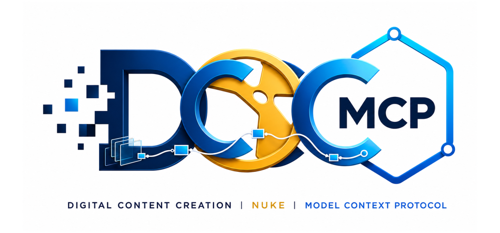
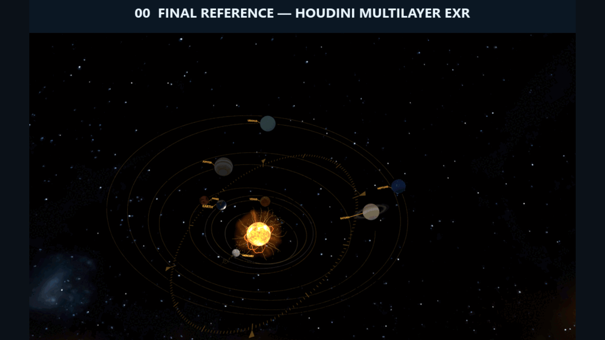

# dcc-mcp-nuke

<p align="center">
  
</p>

<!-- dcc-mcp-coverage-pointer:start -->
<!-- Generated from dcc-mcp-catalog.yml by scripts/generate_adapter_pointer.py in dcc-mcp/dcc-mcp-core. Do not edit by hand. -->
## Part of the DCC-MCP host matrix

**dcc-mcp-nuke** — Foundry Nuke adapter for DCC-MCP.

It is one of **47 host adapters** in the DCC-MCP catalog. Every adapter speaks the same
MCP protocol and builds on the same core runtime contract; each one exposes the tools
its own host needs on top of that.

- [All host adapters and install metadata](https://dcc-mcp.github.io/ecosystem)
- [Host matrix on the core README](https://github.com/dcc-mcp/dcc-mcp-core#readme)
- [Showcase](https://dcc-mcp.github.io/showcase)

This block is generated from the catalog entry in
[`dcc-mcp-catalog.yml`](https://github.com/dcc-mcp/dcc-mcp-core/blob/main/dcc-mcp-catalog.yml).
Re-run the generator after changing the catalog.
<!-- dcc-mcp-coverage-pointer:end -->

## Agent workflow

AI agents should use the shared gateway through `dcc-mcp-cli`; IDE users may
continue to use the MCP endpoint. Prefer typed skills and tools over raw scripts.

### Install or update the CLI

`dcc-mcp-cli` is the preferred control path for every shell-capable agent. If
it is missing, ask the user before installing the latest official release:

```bash
# Linux/macOS
curl -fsSL https://raw.githubusercontent.com/dcc-mcp/dcc-mcp-core/main/scripts/install-cli.sh | sh

# Windows PowerShell
powershell -ExecutionPolicy Bypass -c "irm https://raw.githubusercontent.com/dcc-mcp/dcc-mcp-core/main/scripts/install-cli.ps1 | iex"
```

Keep an official build current through the release manifest:

```bash
dcc-mcp-cli update check
dcc-mcp-cli update apply
```

`update apply` downloads and stages the latest CLI for the next launch. It
does not update a running `dcc-mcp-server`; update that server in its own
environment.

```bash
dcc-mcp-cli dcc-types
dcc-mcp-cli list
dcc-mcp-cli search --query "<task>" --dcc-type nuke
dcc-mcp-cli describe <tool-slug>
dcc-mcp-cli call <tool-slug> --json '{"key":"value"}'
```

`dcc-types` reports release-catalog support; `list` reports live sessions. If a
tool belongs to an inactive progressive skill, call `dcc-mcp-cli load-skill <skill-name> --dcc-type nuke` before retrying. For post-task improvement,
attach a stable session id with `--meta-json`, query `dcc-mcp-cli stats --range 24h --session-id <task-id>`, then pass the bounded evidence to the
`review_skill_improvement` prompt from `dcc-mcp-skills-creator`.


Nuke adapter for the DCC Model Context Protocol. It embeds a Streamable HTTP
MCP server in Nuke and uses Nuke's main-thread execution API for scene tools.

See [install.md](install.md) for the agent-first install, verify, upgrade, and
receipt-driven uninstall workflow on Windows, macOS, and Linux.

## One Nuke family adapter, different runtime contexts

Use **one repository, one `dcc-mcp-nuke` distribution, one installation lifecycle,
and one `dcc-type` (`nuke`)** for the supported Nuke, NukeX and Nuke Studio entry
points. Nuke Studio combines the compositing and Hiero editorial surfaces; it is
not a second MCP product. Switching a workspace changes the UI context, not the
adapter identity. Selecting another running process still requires selecting that
instance, not simply changing a tag.

This packaging decision does **not** mean every edition, license or host version
has the same APIs, Python/Qt runtime, startup hooks or render rights. Separate host
processes do not share an interpreter. Standalone Hiero is part of the planned
family coverage, but its detection, bootstrap and native verification are not yet
implemented by this adapter. Do not override its name to pretend it is Studio.

```bash
dcc-mcp-cli list
dcc-mcp-cli search --query "timeline" --dcc-type nuke
dcc-mcp-cli call nuke_diagnostics__host_flavor --dcc-type nuke --json '{}'
```

When several instances are running, use the selected instance through the gateway
rather than assuming `dcc-type` uniquely identifies a process. Discovery reuses
existing skill/tool tags and search hints; tags describe intent, **not permission**.
The existing `metadata.dcc-mcp.host-flavors` gate prevents loading Studio-only
skills on plain Nuke/NukeX. A search hit does not mean that its skill is loadable.

### Read capability evidence at four separate levels

1. **Declared host surface:** the legacy `capabilities` / `studio_capabilities`
   fields classify expected API domains for the detected flavor. In particular,
   `studio.conform` does not mean a conform tool is implemented.
2. **Observed API shape:** `runtime_evidence` inspects a small, explicit set of
   callable attributes on already loaded `nuke` / `hiero.core` modules. It does
   not import hosts, invoke APIs or inspect every API. `not_loaded` is unknown,
   not proof that an API is unavailable. `observed` is not proof it will execute.
3. **Implemented adapter tool:** only shipped `tools.yaml` entries describe typed
   operations. `nuke-studio-timeline` currently contains just read-only
   `inspect_timeline`: project/sequence summaries, track counts and frame ranges.
   It does not edit tracks, bins, clips or conform/export projects.
4. **Native verification:** a real-host fixture must verify the particular
   operation on the selected version, edition and mode. The diagnostic reports
   `native_verification: not_performed` and `license_status: unknown`; it does not
   certify licenses or turn a smoke test into a blanket capability claim.

The new observations are advisory and do not widen the existing load gate.
The timeline tool independently checks its required Hiero API when called and
returns `studio_surface_unavailable` for a missing project-enumeration surface.
An environment flavor override is a diagnostic aid, never a way to unlock a
missing API or circumvent a license restriction.

See [family coverage and staged delivery](docs/family-capabilities.md) for the
implemented inventory, missing capabilities, runtime isolation and acceptance gates.

## Automated Houdini AOV compositing



This real Nuke session progressively isolates Albedo, Sun, Diffuse, Glossy, and
Emission passes, then merges them into the approved composite. The 35-layer,
114-channel EXR source was rendered from a solar-system scene built in Houdini with
[`dcc-mcp-houdini`](https://github.com/dcc-mcp/dcc-mcp-houdini); Nuke reads the
Houdini AOVs rather than bundled sample footage.

Nuke loads the lifecycle-managed plug-in path and asks the operating system for
an available instance port. Use `dcc-mcp-cli list` or the stable gateway at
`http://127.0.0.1:9765/mcp` to discover and connect to the running instance.
Set `DCC_MCP_NUKE_PORT` only when a fixed direct port is required.

The `nuke-layered-compositing` template adds a composite to the current graph
through checked node CRUD without deleting existing work. It preserves existing
node names, connections, knobs, and selection; collisions get new unique names.
It applies the manifest's Root settings and saves the combined script to the
explicit `script_path`. Failed builds remove only added nodes and restore Root
settings and selection. Read/Write colorspaces use the same enumerated-name
validation as `nuke-color`. Repeated builds add another branch.

The bundled `nuke-script` skill can open an existing absolute `.nk` path,
inspect bounded node topology and knob values, sample per-channel AOV
statistics, and explicitly save the current script. It also starts a fresh
script with `new_script` (guarding unsaved changes), pastes nodes from an
absolute `.nk` file additively with `paste_nodes` without clearing existing
nodes, and reads or sets Root frame range, fps, and format through
`get_root_settings` and `set_root_settings`; root-settings writes validate the
range and enumerate the format list, require a matching readback, and roll back
on mismatch. The `nuke-node-graph`
skill adds non-clearing node CRUD, exact input connections, and readback-
verified static knob edits while rejecting executable knobs. The
`nuke-text-layout` skill creates or updates one bounded
`Text2` label, maps requested pixel size through Nuke's effective
`global_font_scale`, and returns verified node position, text box, and
alignment readback with rollback on mismatch. It rejects arbitrary node
classes, Python, Tcl, scripts, expressions, callbacks, bracket/backslash/control
text, animated/keyed/expression-bearing required knobs, and UI input while
preserving ordinary Unicode labels. Dynamic-state probes must return their
documented boolean, curve-list, and non-negative key-count shapes; unsupported
or unobservable probe results fail closed before mutation. Scale, box, and
position readback must use finite non-boolean numeric values with exact bounded
shapes; malformed readback fails closed and rolls back.

The `nuke-color` skill inspects and sets Nuke color management through bounded
typed verbs. `get_color_management` reports the active Root color-management
mode, the current OCIO config and its enumerated preset list, the working space,
and a bounded enumerated colorspace list without changing the script. The
`set_ocio_config`, `set_read_colorspace`, `set_write_colorspace`, and
`set_display_transform` verbs accept only names drawn from the enumerated lists,
reject unknown values instead of silently storing them, and require a matching
readback with rollback on mismatch.

The `nuke-paths` skill discovers every `File_Knob` recursively, including file
references inside groups and gizmos, and reports raw/evaluated paths and file
or sequence existence. Its prefix remap, absolute/script-relative conversion,
and unique missing-file relink tools default to dry run, preserve expressions
and animated knobs, and verify each write with whole-operation rollback on
failure. Reference lists and folder searches are bounded; ambiguous relinks
remain unchanged. These host-injected helpers also work in headless `nuke -t`.

The `nuke-preview` skill renders one node/frame to a temporary RGB PNG with a
bounded longest edge, file reference, source bounding box, and sampled channel
statistics. Select an RGB layer or one exact channel for grayscale inspection;
optional OCIO display/view names use the active config's enumerated lists.
The tool restores frame, proxy mode, selection, dirty state, group context,
and undo recording, and removes its temporary graph. Release each returned
`preview_id` with `cleanup_preview` after reading the image. Up to eight
previews (8 MiB each) live until cleanup or normal host exit; raw output clips
to [0, 1] and does not claim parity with a custom Viewer process.

The `nuke-input-health` skill checks input files, bounded sequence gaps and
frame sizes, Root/Read/optional Write range coverage, and required plug-in
classes without editing the graph. Issues are grouped by severity with
compressed frame ranges; limit and inspection failures are explicit. Supply
required classes from a handoff manifest to check dependencies absent from the
active graph. Third-party license availability requires separate verification.

The `nuke-collect` skill previews or packages the active script into a new
directory or zip with bounded dependency copies, a relative-path script and a
manifest. It supports full sequences or Nuke's used-frame dependency query,
geometry/LUT/config file knobs, discoverable plug-in scripts and native fonts.
Missing files, expressions, unresolved OCIO LUTs/imports, and compiled runtime
requirements are reported explicitly. Live knob serialization, Root state and
the original disk script are preserved; the async copy checks cancellation and
never overwrites an existing target. `inspect_package` verifies the receipt and
stored file sizes before handoff.

Releases use a canonical tag and exact-main identity check, one digest-bound
wheel/sdist bundle, and a minimal-OIDC publisher in `release.yaml` and the
GitHub `pypi` environment. Immediately before publishing, the workflow force-refreshes
authoritative main and tag refs into an isolated namespace and repeats the
identity checks. CI obtains the Install SOP schema from the isolated minimum-
Core environment used for the installed-wheel smoke rather than its ambient
interpreter.

The `nuke-plugins` skill inspects ordered host search paths, available and loaded
plug-in files, registered classes, and explicitly named local task roots without
loading code or changing the graph. Required classes distinguish registration
from filename candidates and incomplete checks; ABI, licenses and rendering
remain separate verification steps. Use the existing node-graph and Gizmo tools
after selecting a trusted asset. The skill's source references explain where to
find Gizmos and how to review, pin, download and use them.

The `nuke-node-assets` skill packages reusable, versioned Gizmos with an
explicit public knob interface, instantiates saved assets, and validates live
instances. Its registered tools use `DCC_MCP_NUKE_PLUGIN_ROOT`, stable ids and
versions, bounded typed knobs, and reject executable callbacks.

The `nuke-layered-compositing` skill supports ordered global and
Cryptomatte-scoped gain, saturation, edge-feather, and bounded albedo-fill
adjustments without changing pixels outside the selected material.
